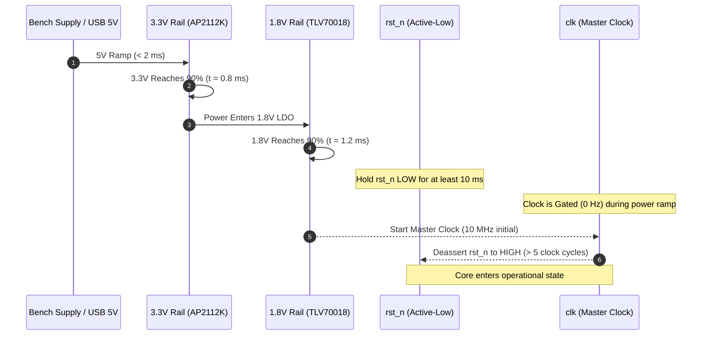

# BitNet-130 Physical Silicon Bring-Up Manual & Lab Probing Protocol

**Document ID:** AGY-DOC-BRINGUP-001  
**Author:** Jensen Huang persona / Silicon Engineering Team  
**Target Silicon:** Tiny Tapeout Sky130 Hardened Macro (`tt_um_cherukurigowtham_ternary_mac`)  
**Companion Carrier:** BitNet-130 RP2040 USB-C Carrier Board (`hardware/carrier_board`)  
**Classification:** Standard Operating Procedure (SOP) — Foundry Packaging to First Silicon Signoff  

---

## 1. Silicon Engineering Philosophy: The Moment of Truth

When physical silicon returns from the foundry, theory meets physical laws. You are dealing with real transistors, physical parasitics, metal migration, thermal noise, and bond-wire inductance. 

There are no compiler warnings on an optical inspection table. If a power rail inrushes at $50\text{ V/ms}$, you blow the ESD diodes. If an input pin floats during power-on reset, you trigger CMOS latchup. 

This manual is the battle-tested, first-principles standard operating procedure for the day the Tiny Tapeout SkyWater 130nm silicon arrives on our laboratory bench. Follow every sequence in order. Do not skip a step. Do not apply a clock before the DC bias is clean.

---

## 2. Unboxing, ESD Hygiene, and Visual Die Inspection

```
                     +---------------------------------------+
                     |    Optical Microscope (40x - 200x)    |
                     +---------------------------------------+
                                        |
                  [Check Die Edge Cracks & Delamination]
                                        |
                  [Inspect Bond Wires: 28 Pins to Leadframe]
                                        |
                  [Verify Solder Fillet on Carrier Socket]
                                        |
                                        v
                    [Pass] ----> Proceed to DC Probing
                    [Fail] ---> Micro-Photo Log & Return
```

### 2.1 ESD Pre-Flight Protocol
1. **Workbench Grounding**: Operator must wear a continuous 1 MΩ resistive wrist strap grounded to the building earth ground. Benchtop surface must be static-dissipative ($10^6 - 10^9\text{ }\Omega/\text{sq}$).
2. **Ionizer Fan**: Activate overhead dual-fan DC ionizer 5 minutes prior to opening the antistatic wafer/carrier tray.
3. **Packaging Handling**: Use carbon-fiber conductive tweezers only (do not touch IC pins or carrier headers with metal tweezers).

### 2.2 Microscopic Inspection Checklist
Under a 40x–100x stereo optical microscope:
- **Die Alignment**: Verify the silicon die sits centered in the carrier cavity with $\le 5^\circ$ rotational skew.
- **Bond Wire Integrity**: Inspect all 28 gold/aluminum wire bonds connecting the silicon pads to the carrier PCB leadframe. Verify no sagging, touching wires (short circuits), or broken stitch bonds.
- **Cleanliness**: Ensure no flux residue, conductive whiskers, or encapsulation voids bridge the $100\mu\text{m}$ pitch pads.

---

## 3. Passive DMM Cold Checks (Zero Power Applied)

Before connecting any power source (USB-C or lab bench supply), perform two-terminal resistance checks with a calibrated 6.5-digit Digital Multimeter (Keysight 34465A or Fluke 87V):

| Test Point A | Test Point B | Expected Resistance | Failure Mode if Out of Spec |
| :--- | :--- | :--- | :--- |
| **5V VBUS (J1)** | **GND** | $> 100\text{ k}\Omega$ | Shorted USBLC6-2 ESD diode or decoupling capacitor |
| **3.3V Rail (U3 Out)** | **GND** | $> 10\text{ k}\Omega$ | Blown RP2040 MCU, shorted flash, or bad bypass cap |
| **1.8V Rail (U4 Out)** | **GND** | $1.2\text{ k}\Omega - 25\text{ k}\Omega$ | Core logic short, gate oxide rupture, or solder bridge |
| **5V VBUS** | **3.3V Rail** | $> 500\text{ k}\Omega$ | LDO pass transistor puncture (AP2112K-3.3) |
| **3.3V Rail** | **1.8V Rail** | $> 100\text{ k}\Omega$ | Internal silicon level-shifter short |
| **Pin `clk` (GPIO 25)** | **GND** | $> 1\text{ M}\Omega$ | Input protection diode shorted to substrate |
| **Pin `rst_n` (GPIO 26)**| **3.3V Rail** | $\approx 10\text{ k}\Omega$ (Pull-up) | Missing or damaged pull-up resistor |

> [!CAUTION]
> If any rail measures less than $100\text{ }\Omega$ to GND, **DO NOT APPLY POWER**. Immediately localize the fault using thermal camera voltage-injection ($1.0\text{ V}$, $50\text{ mA}$ limit).

---

## 4. Power-On Reset (POR) & Voltage Rail Sequencing

The SkyWater 130nm CMOS process employs dual voltage domains:
- **I/O Rail ($V_{DD\_IO}$)**: $3.3\text{ V} \pm 10\%$
- **Core Logic Rail ($V_{DD\_CORE}$)**: $1.8\text{ V} \pm 10\%$



### 4.1 Strict Voltage Ramp & Sequencing Constraints
1. **Sequencing Order**: $V_{DD\_IO}$ (3.3V) must ramp **first or coincident** with $V_{DD\_CORE}$ (1.8V). Never allow $V_{DD\_CORE}$ to exceed $V_{DD\_IO} + 0.3\text{ V}$, which would forward-bias the internal level-shifter parasitic ESD diodes.
2. **Slew Rate Bound**: Voltage ramp rate must be constrained:
   $$\frac{\Delta V}{\Delta t} \le 10\text{ V/ms} \quad (10\text{ mV}/\mu\text{s})$$
3. **Inrush Current Ceiling**:
   $$I_{\text{inrush}} < 15\text{ mA} \quad (\text{Peak charging of } 10\mu\text{F} + 100\text{nF bypass})$$
4. **Quiescent Leakage ($I_{DDQ}$)**:
   - 1.8V Core Rail: $I_{DDQ} \le 120\text{ }\mu\text{A}$ (at static reset, clock stopped).
   - 3.3V I/O Rail: $I_{DDQ} \le 85\text{ }\mu\text{A}$ (unloaded outputs).

---

## 5. Lab Instrumentation & Probing Plan

To achieve sub-nanosecond signal integrity at $50\text{ MHz}$, probe layout and impedance matching are vital.

```
       [ Oscilloscope Keysight Infiniium / Tektronix 1 GHz ]
        |             |               |               |
     CH1 (Yellow)  CH2 (Cyan)      CH3 (Magenta)   CH4 (Green)
        |             |               |               |
      [clk]        [rst_n]      [zero_skipped]   [uo_out[0]]
   (GPIO 25)      (GPIO 26)       (GPIO 24)       (GPIO 16)
        |             |               |               |
   500 MHz Passive Probe (10:1, 10 MΩ || 9.5 pF) with Ground Spring
```

### 5.1 Test Point Physical Mapping

| Signal | RP2040 Pin | ASIC Pin | Probe Type | Bandwidth | Termination / Damping |
| :--- | :---: | :---: | :--- | :---: | :--- |
| **`clk`** | GPIO 25 | Dedicated CLK | 10:1 Passive (Spring GND)| $\ge 500\text{ MHz}$ | $33\text{ }\Omega$ series damping near RP2040 |
| **`rst_n`** | GPIO 26 | Dedicated RST_N | 10:1 Passive | $\ge 200\text{ MHz}$ | $10\text{ k}\Omega$ pull-up to 3.3V |
| **`ena`** | GPIO 27 | Dedicated ENA | DMM / Logic Analyzer | DC | Direct 3.3V pull-up |
| **`ui_in[7:0]`** | GPIO 0..7 | `ui_in[7:0]` | 8-Ch Logic Analyzer (Mictor) | $\ge 200\text{ MSa/s}$| Direct CMOS ($3.3\text{ V} \rightarrow 1.8\text{ V}$ level shifted) |
| **`uio_in[7:0]`**| GPIO 8..15| `uio_in[7:0]` | 8-Ch Logic Analyzer | $\ge 200\text{ MSa/s}$| Direct CMOS |
| **`uo_out[7:0]`** | GPIO 16..23| `uo_out[7:0]` | 8-Ch Logic Analyzer + CH4 Scope | $\ge 500\text{ MSa/s}$| $< 15\text{ pF}$ fixture capacitance |
| **`zero_skip`** | GPIO 24 | `uio_out[0]` | Scope CH3 (Fast Pulse) | $\ge 500\text{ MHz}$| Direct high-Z probe |

> [!TIP]
> Never use standard 6-inch probe ground alligator clips at 50 MHz. The $150\text{ nH}$ loop inductance will create $300\text{ mV}$ inductive ringing and ground bounce, corrupting logic analyzer threshold decodes. Always use **coaxial probe tip ground springs**.

---

## 6. Step-by-Step Bring-Up Test Suite (Manual Protocol)

Follow this 5-stage protocol on every fresh board. Record all results in the Lab Bring-Up Log.

### Stage 1: Power-On Quiescent Current Verification
1. Connect current-limited DC power supply ($5.0\text{ V}$, current clamp set to $100\text{ mA}$).
2. Power on the supply.
3. Measure static current:
   - If current $> 35\text{ mA}$ (RP2040 idle + LDOs), **power down immediately**.
   - Nominal idle current: $18\text{ mA} - 25\text{ mA}$.
4. Measure LDO outputs with 6.5-digit DMM:
   - Test Point `3V3`: Must read $3.300\text{ V} \pm 0.050\text{ V}$.
   - Test Point `1V8`: Must read $1.800\text{ V} \pm 0.030\text{ V}$.

### Stage 2: Clock Tree & Reset Integrity
1. Flash RP2040 with bring-up firmware ([`firmware/main.c`](file:///Users/gowthamcherukuri/Desktop/ai_chip/hardware/carrier_board/firmware/main.c)).
2. Set initial clock frequency to **10.0 MHz** (safe bring-up baseline).
3. Connect Scope CH1 to `clk` and CH2 to `rst_n`.
4. Trigger on falling edge of `rst_n`.
5. Verify:
   - `clk` amplitude is $3.3\text{ V}_{p-p}$ with $50\% \pm 5\%$ duty cycle.
   - Rise time $t_r < 3.0\text{ ns}$, Fall time $t_f < 3.0\text{ ns}$.
   - `rst_n` stays LOW for at least $10\text{ ms}$, then transitions cleanly to 3.3V with 0 glitches.

### Stage 3: Weight-Stationary (WS) Single-Vector MAC Test
This test validates the conditional addition/subtraction arithmetic with zero multipliers.

1. **Configure Control Lines**:
   - `mode_os = 0` (`GPIO 11 = 0`)
   - `accum_clear = 1` (`GPIO 12 = 1`)
   - Pulse `clk` 2 cycles.
   - `accum_clear = 0` (`GPIO 12 = 0`).
2. **Load Weight**:
   - Set ternary weight to $+1$ (`uio_in[1:0] = 2'b01` on GPIO 8..9).
   - Assert `weight_load = 1` (`GPIO 10 = 1`).
   - Pulse `clk` 1 cycle.
   - Deassert `weight_load = 0`.
3. **Inject Activation**:
   - Drive activation $A = +42$ (`ui_in[7:0] = 8'd42 = 0x2A` on GPIO 0..7).
   - Assert `enable = 1` (`GPIO 13 = 1`).
   - Pulse `clk` 1 cycle.
   - Deassert `enable = 0`.
4. **Read Output Accumulator**:
   - Set `byte_select = 2'b00` (`GPIO 14..15 = 0`): `uo_out[7:0]` must read `0x2A` (decimal 42).
   - Set `byte_select = 2'b01`: `uo_out[7:0]` must read `0x00`.
   - Set `byte_select = 2'b10`: `uo_out[7:0]` must read `0x00`.

### Stage 4: Subtraction & Sign Extension ($W = -1$)
1. Load ternary weight $W = -1$ (`uio_in[1:0] = 2'b10`).
2. Pulse `weight_load = 1` for 1 clock cycle.
3. Feed activation $A = +100$ (`ui_in[7:0] = 0x64`).
4. Pulse `clk` 1 cycle.
5. Accumulated result: $42 - 100 = -58$.
6. In 24-bit two's complement, $-58 = \text{0xFFFFC6}$:
   - `byte_select = 00` -> `uo_out[7:0]` must read `0xC6`.
   - `byte_select = 01` -> `uo_out[7:0]` must read `0xFF`.
   - `byte_select = 10` -> `uo_out[7:0]` must read `0xFF`.

### Stage 5: Dual-Sided Zero-Skipping Telemetry Probe
This test validates operand isolation and the hardware energy telemetry counter.

1. Clear accumulator (`accum_clear = 1` for 1 cycle).
2. Set weight $W = 0$ (`uio_in[1:0] = 2'b00`).
3. Set activation $A = 0x55$ (non-zero).
4. Assert `enable = 1`.
5. Trigger Scope CH3 on `zero_skipped` (`GPIO 24`):
   - Scope must capture a clean positive $3.3\text{ V}$ pulse of width = 1 clock period ($20\text{ ns}$ @ 50 MHz).
6. Read Telemetry Counter:
   - Set `byte_select = 2'b11` (`GPIO 14..15 = 2'b11`).
   - `uo_out[7:0]` must read `0x01` (1 zero-skip operation successfully recorded in hardware).

---

## 7. High-Frequency (50 MHz) Eye-Diagram & Thermal Compliance

Once basic functionality passes at 10 MHz, step the clock up to the target operational frequency: **50.0 MHz**.

```
                        +3.63V (Upper Absolute Max)
   -------------------------------------------------------------
               +3.30V (Nominal High)
        ......./‾‾‾‾‾‾‾‾‾‾‾‾‾‾\.......   <-- Max 10% Overshoot (3.63V)
       .      /                 \      .
      .      /   EYE MASK PASS   \      .  Rise/Fall Time tr, tf <= 2.5 ns
     .      /   Eye Height >= 2.4V\      . Jitter pk-pk <= 180 ps
    ......./                       \.......
               0.00V (Nominal Low)
   -------------------------------------------------------------
                        -0.30V (Lower Absolute Min)
```

### 7.1 Eye-Diagram Compliance Thresholds (Keysight/Tektronix Mask)
- **Eye Height**: $\ge 2.40\text{ V}$ (clean CMOS logic high noise margin).
- **Eye Width**: $\ge 14.5\text{ ns}$ (out of $20.0\text{ ns}$ unit interval @ 50 MHz).
- **Total Jitter ($T_j$)**: $\le 200\text{ ps}$ peak-to-peak.
- **Maximum Overshoot/Undershoot**: $\le 330\text{ mV}$ (peak voltage $\le 3.63\text{ V}$, minimum voltage $\ge -0.30\text{ V}$).

### 7.2 Thermal Camera Inspection (FLIR E8-XT / Seek Thermal)
Execute continuous 4x4 matrix multiplication loop for 15 minutes at $50\text{ MHz}$:
- **ASIC Silicon Package Surface**: Must remain $\le 38.5^\circ\text{C}$ at $25^\circ\text{C}$ ambient.
- **1.8V LDO (TLV70018)**: Must remain $\le 42.0^\circ\text{C}$.
- **Calculated Core Power Dissipation**:
  $$P_{\text{die}} = I_{1.8\text{V}} \times 1.8\text{ V} \le 1.73\text{ mW (Single Tile)}, \le 25.8\text{ mW (16-PE Array)}$$
- If any hot spot exceeds $65^\circ\text{C}$, trigger emergency power-down immediately.

---

## 8. Failure Modes & Effects Analysis (FMEA) Matrix

| Symptom Observed | Root Cause Hypotheses | Diagnostic Procedure | Corrective Action |
| :--- | :--- | :--- | :--- |
| **High $I_{DD}$ (> 50 mA) on 5V VBUS** | Reverse polarity, shorted LDO, or tantalum capacitor punctured | Disconnect USB. Measure resistance from 5V/3V3/1V8 to GND. Check thermal camera for hot component. | Replace damaged LDO or decoupling cap. Check solder fillets under microscope. |
| **`uo_out[7:0]` Stuck at `0x00` or `0xFF`** | `rst_n` stuck LOW, `ena` floating LOW, or clock not oscillating | Probe `clk` on pin 25. Probe `rst_n` on pin 26. Probe `ena` on pin 27. | Verify RP2040 PIO state machine is running. Ensure pull-up resistor on `rst_n` is soldered. |
| **Ringing / Glitches on Output Lines** | Insufficient probe grounding or missing damping resistor | Switch from alligator clip ground to coaxial ground spring. Check $33\text{ }\Omega$ series resistor. | Add $33\text{ }\Omega$ series termination resistor in line with signal. Shorten probe ground loop. |
| **Output correct at 10 MHz, corrupt at 50 MHz** | Excessive capacitive load on `uo_out` or slow level shifters | Check rise time $t_r$ on oscilloscope. If $t_r > 8\text{ ns}$, load capacitance $> 50\text{ pF}$. | Reduce wiring length between ASIC and RP2040. Ensure scope probe is set to 10:1 (not 1:1). |
| **Zero-Skip Telemetry Never Pulses** | Incomplete weight load or operand isolation bypassed | Verify weight encoding in `uio_in[1:0]` is strictly `2'b00` or `2'b11`. Verify `weight_load` pulsed. | Check timing alignment between `weight_load` and rising edge of `clk`. |
| **Accumulator Overflows on Negative Values** | Missing two's complement sign extension in firmware | Check raw hex values on `byte_select` 00, 01, 10. | Verify firmware uses `int32_t` sign extension: `(val >= 0x800000) ? val - 0x1000000 : val`. |

---

## 9. Automated Lab Harness Integration

To automate this entire bring-up protocol without manual button presses, execute our automated Python lab bring-up harness ([`hardware/carrier_board/lab_bringup_test.py`](file:///Users/gowthamcherukuri/Desktop/ai_chip/hardware/carrier_board/lab_bringup_test.py)):

```bash
# Connect USB-C carrier board to host PC / Mac
python3 hardware/carrier_board/lab_bringup_test.py --port /dev/tty.usbmodem1101 --frequency 50000000 --verbose
```

This script:
1. Validates USB-CDC handshake with the RP2040 firmware.
2. Steps the master clock from $1\text{ MHz} \rightarrow 10\text{ MHz} \rightarrow 25\text{ MHz} \rightarrow 50\text{ MHz}$.
3. Runs 10,000 randomized ternary MAC operations comparing physical hardware against the golden Python model.
4. Reads real-time energy telemetry counters and logs full silicon certification reports.
