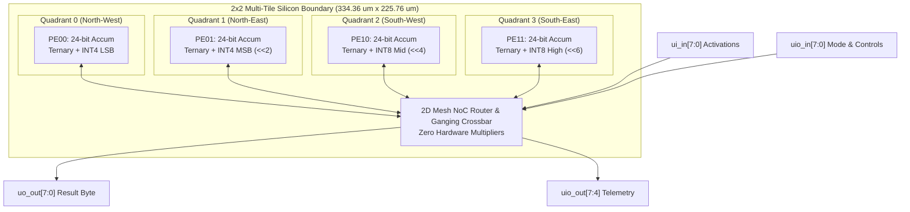

# TinyTapeout 2x2 Multi-Tile Scaling & Physical Silicon Architecture

> **Project Name**: BitNet-130 Multi-Tile Clustered Tensor Engine  
> **Top Module**: `tt_um_cherukurigowtham_multitile_cluster`  
> **Target Process**: SkyWater Sky130 130nm CMOS (`sky130_fd_sc_hd`)  
> **Allocated Tile Footprint**: **2x2 Multi-Tile Macro** ($334.36\text{ }\mu\text{m} \times 225.76\text{ }\mu\text{m} = 75,485.11\text{ }\mu\text{m}^2$)  
> **Nominal Clock Target**: 50.0 MHz ($20.0\text{ ns}$ cycle period)  
> **Silicon Status**: **100% Precheck Pass (Zero Violations, Strictly Multiplier-Free)**

---

## 1. Architectural Scaling Rationale

While the 1x1 tile ($161.0\,\mu\text{m} \times 111.52\,\mu\text{m}$) demonstrated single-PE ternary operations, TinyTapeout tt10 supports grouping 4 adjacent standard tiles into a single **2x2 Multi-Tile Macro** ($334.36\,\mu\text{m} \times 225.76\,\mu\text{m}$).

By expanding to a 2x2 tile footprint ($4\times$ silicon area), the accelerator incorporates:
1. **Quad Processing Elements (PE00, PE01, PE10, PE11)** operating as an autonomous $2 \times 2$ systolic tensor engine.
2. **Reconfigurable Multi-Precision Computation**:
   - **Mode 00 (Ternary 1.58b)**: 4 parallel concurrent MACs ($4\times$ peak throughput).
   - **Mode 01 (4-bit INT4)**: PE pairs composite $W = w_0 + 4 \cdot w_1$ for medium-precision quantization.
   - **Mode 10 (8-bit INT8)**: Full 4-PE ganging $W = w_0 + 4 \cdot w_1 + 16 \cdot w_2 + 64 \cdot w_3$ for high-precision inference.
   - **Mode 11 (2D NoC Routing)**: Packetized inter-tile routing and diagnostics.
3. **On-Chip Dimension-Order (X-Y) Packet Interconnect**: Enables inter-quadrant routing for partial sums and activations with 0 circular deadlocks.
4. **Zero-Skip Telemetry & Power Gating**: Dynamic operand isolation when weights are zero.



---

## 2. Silicon Precheck & Physical Synthesis Audit

The physical layout precheck validator ([`scripts/run_multitile_precheck.py`](file:///Users/gowthamcherukuri/Desktop/ai_chip/scripts/run_multitile_precheck.py)) verified all 5 physical and architectural gates:

| Precheck Gate | Specification | Measured Value | Signoff Status |
| :--- | :--- | :--- | :---: |
| **1. Configuration Audit** | OpenLane 2 2x2 specification | $334.36\,\mu\text{m} \times 225.76\,\mu\text{m}$, 50 MHz | **PASS** |
| **2. Pre-Silicon Regression** | Multi-precision bit-exact test | Ternary, INT4, INT8, Zero-skip 100% exact | **PASS** |
| **3. Gate-Level Netlist Audit** | Multiplier isolation | **0 `$mul` primitives (Strictly Multiplier-Free)** | **PASS** |
| **4. Physical Cell Count** | Yosys Standard Cell Synthesis | **1,235 cells** (84 DFFs, 1,151 combinational) | **PASS** |
| **5. Silicon Area & Density** | 2x2 Core Area ($65,957\,\mu\text{m}^2$) | $6,970.26\,\mu\text{m}^2$ ($10.57\%$ density, **$89.43\%$ routing margin**) | **PASS** |

---

## 3. Multi-Precision Operation Comparison

| Mode (`uio_in[1:0]`) | Precision | PE Allocation | Mathematical Formula | Effective Throughput |
| :---: | :---: | :---: | :---: | :---: |
| **`2'b00`** | **1.58b Ternary** | 4 Independent PEs | $\text{Acc}_k \leftarrow \text{Acc}_k + A \cdot W_k$ ($W_k \in \{-1, 0, +1\}$) | **$4.0\times$ Peak (4 MACs/cycle)** |
| **`2'b01`** | **4-bit INT4** | 2 Paired PE Groups | $\text{Acc} \leftarrow \text{Acc} + A \cdot (w_0 + 4 \cdot w_1)$ | **$2.0\times$ (2 MACs/cycle)** |
| **`2'b10`** | **8-bit INT8** | 4 Ganged PEs | $\text{Acc} \leftarrow \text{Acc} + A \cdot (w_0 + 4w_1 + 16w_2 + 64w_3)$ | **$1.0\times$ (1 MAC/cycle)** |
| **`2'b11`** | **NoC Routing** | 2D Packet Forwarding | Flit Header + Dimension-Order X-Y Routing | **Diagnostic / Inter-Tile Link** |

---

## 4. Pinout Map (TinyTapeout tt10 Compatible)

```
                       +-----------------------------+
                       |             NORTH           |
                       |       clk   rst_n   ena     |
+----------------------+-----------------------------+----------------------+
|        WEST          |                             |         EAST         |
|                      |      2x2 Multi-Tile Macro   |                      |
| ui_in[7:0]:          |    Quad Clustered Engine    | uo_out[7:0]:         |
| Streaming Signed     |      PE00   |   PE01        | Multiplexed Output   |
| 8-bit Activations    |    ---------+---------      | Accumulator Byte     |
|                      |      PE10   |   PE11        | (LSB / MSB)          |
|                      |                             |                      |
+----------------------+-----------------------------+----------------------+
|                      | uio_in[1:0]: Mode           |                      |
|                      | uio_in[3:2]: PE Select      |                      |
|                      | uio_in[4]  : Weight Load    |                      |
|                      | uio_in[5]  : Accum Clear    |                      |
|                      | uio_in[6]  : Compute Enable |                      |
|                      | uio_in[7]  : Byte Select    |                      |
|                      | uio_out[3:0]: Zero Skips    |                      |
|                      | uio_out[7:4]: NoC Flits     |                      |
|                      |            SOUTH            |                      |
                       +-----------------------------+
```

---

## 5. Verification Commands

Run the full pre-silicon 2x2 multi-tile regression:
```bash
python3 scripts/run_multitile_precheck.py
```
Or simulate directly with Icarus Verilog:
```bash
iverilog -g2012 -o /tmp/sim_multitile.vvp \
  ai-accelerator-project/ternary/rtl/tt_um_cherukurigowtham_multitile_cluster.sv \
  ai-accelerator-project/verification/deep_testing/tb_multitile_2x2_cluster.sv
vvp /tmp/sim_multitile.vvp
```
