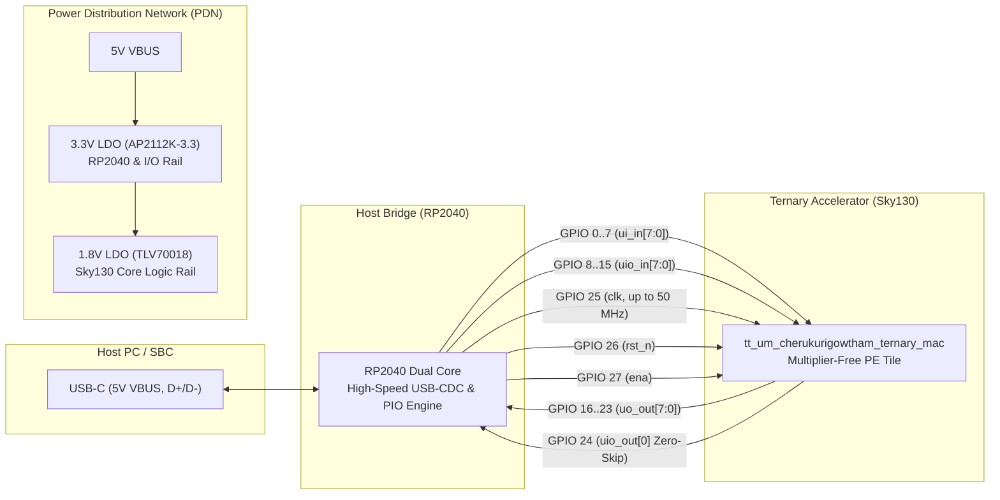

# BitNet-130 USB-C Carrier Board: Hardware Design Specification

**Target Product**: BitNet-130 Developer Evaluation Module  
**Form Factor**: Compact USB-C Dongle / Breadboard-Friendly Header Module ($55\text{ mm} \times 24\text{ mm}$)  
**Host Controller**: Raspberry Pi RP2040 Dual ARM Cortex-M0+ @ 133 MHz  
**Target Silicon**: SkyWater Sky130 Hardened Ternary MAC Tile (Tiny Tapeout Shuttle)  
**PCB Layers**: 4-Layer FR-4 (Signal - GND - 3V3/1V8 Power - Signal), 1.6 mm, ENIG Gold Finish  

---

## 1. System Block Diagram

---

## 2. Electrical Pin Mapping Matrix

| RP2040 Pin | Function / Direction | Sky130 ASIC Pin | Function Description |
| :--- | :---: | :--- | :--- |
| **GPIO 0 .. 7** | Output (Host $\rightarrow$ ASIC) | `ui_in[7:0]` | Signed 8-bit input activations ($A \in [-128, 127]$) |
| **GPIO 8 .. 9** | Output (Host $\rightarrow$ ASIC) | `uio_in[1:0]` | 2-bit Ternary Weight ($\{00=\text{Zero}, 01=+1, 10=-1\}$) |
| **GPIO 10** | Output (Host $\rightarrow$ ASIC) | `uio_in[2]` | `weight_load` (WS Mode: Latch stationary weight) |
| **GPIO 11** | Output (Host $\rightarrow$ ASIC) | `uio_in[3]` | `mode_os` (0: Weight-Stationary, 1: Output-Stationary) |
| **GPIO 12** | Output (Host $\rightarrow$ ASIC) | `uio_in[4]` | `accum_clear` (Synchronous clear accumulator) |
| **GPIO 13** | Output (Host $\rightarrow$ ASIC) | `uio_in[5]` | `enable` (Compute execution enable) |
| **GPIO 14 .. 15**| Output (Host $\rightarrow$ ASIC) | `uio_in[7:6]` | `byte_select[1:0]` (Accumulator byte mux readback) |
| **GPIO 16 .. 23**| Input (ASIC $\rightarrow$ Host) | `uo_out[7:0]` | 8-bit Output Bus (Multiplexed 24-bit Accumulator & Status) |
| **GPIO 24** | Input (ASIC $\rightarrow$ Host) | `uio_out[0]` | Real-time `zero_skipped` dynamic telemetry pulse |
| **GPIO 25** | PIO Output (Host $\rightarrow$ ASIC) | `clk` | Accelerator master clock (programmable 1 MHz – 50 MHz) |
| **GPIO 26** | Output (Host $\rightarrow$ ASIC) | `rst_n` | Active-low hardware system reset |
| **GPIO 27** | Output (Host $\rightarrow$ ASIC) | `ena` | Power domain enable (logic high = 1) |

---

## 3. Power Distribution Network (PDN)

- **Input**: Standard USB-C 5V VBUS (Protected via USBLC6-2SC6 ESD protection array and 500mA PTC resettable fuse).
- **3.3V Rail**: Regulated via Diodes Inc. `AP2112K-3.3` (SOT-23-5, 600mA output, low noise, $55\text{ dB}$ PSRR). Powers the RP2040 MCU, flash memory, and Sky130 3.3V I/O domain.
- **1.8V Rail**: Regulated via Texas Instruments `TLV70018` (SOT-23-5, 200mA output, low quiescent current). Powers the Sky130 1.8V digital core logic.
- **Decoupling Strategy**:
  - $1\times 10\mu\text{F}$ ceramic bulk capacitor on each LDO output.
  - $1\times 100\text{nF}$ 0402 X7R bypass capacitor placed directly adjacent to every VDD pin on the silicon carrier.

---

## 4. Turnkey Bill of Materials (BOM) — 200 Units Production

| RefDes | Description | Part Number | Package | Manufacturer | LCSC Part # | Unit Price (1k) |
| :--- | :--- | :--- | :---: | :--- | :---: | :---: |
| **U1** | Dual ARM Cortex-M0+ MCU | RP2040 | QFN-56 | Raspberry Pi | C2040 | \$0.80 |
| **U2** | 16MB QSPI Flash Memory | W25Q128JVSIQ | SOIC-8 | Winbond | C97521 | \$0.42 |
| **U3** | Ultra-Low Noise 3.3V LDO | AP2112K-3.3TRG1 | SOT-23-5 | Diodes Inc. | C397342 | \$0.18 |
| **U4** | High PSRR 1.8V LDO | TLV70018DDCR | SOT-23-5 | Texas Instruments | C123490 | \$0.22 |
| **U5** | 4-Channel ESD Protection | USBLC6-2SC6 | SOT-23-6 | STMicroelectronics | C7519 | \$0.08 |
| **J1** | 16-Pin USB Type-C Receptacle | TYPE-C-31-M-12 | SMD-16 | Korean Hroparts | C165948 | \$0.24 |
| **Y1** | 12.000 MHz Crystal Oscillator | SMD3225-4P 12MHz | 3225-4P | Yangxing Tech | C9002 | \$0.09 |
| **F1** | 500mA PTC Resettable Fuse | SMD1206P050TF | 1206 | Polytronics | C36915 | \$0.05 |
| **D1, D2**| Status LEDs (Green/Blue) | 0603 LED | 0603 | Everlight | C72043 | \$0.02 |
| **R, C** | Passives (0402/0603 Caps & Res) | Standard 1% SMD | 0402 / 0603 | Yageo / Samsung | Various | \$0.25 |
| **SOCKET**| Tiny Tapeout Silicon Socket | 2x14 2.54mm Headers | THT-28 | Wurth / Harwin | C12439 | \$0.40 |
| **Total Components BOM per Unit** | | | | | | **\$2.75** |

*(Total board assembly cost with 4-layer PCB + automated SMT assembly at JLCPCB/PCBWay: $\approx \$11.50$ per finished module at 200 units).*

---

## 5. Firmware Architecture (RP2040 Bridge)

The RP2040 hosts an ultra-low latency C/C++ firmware built on the Pico SDK:
1. **Core 0**: Handles USB-CDC serial communication and USB-HID endpoints, decoding JSON/Binary GEMM requests from the Python SDK (`bitnet-accel`).
2. **Core 1 & PIO (Programmable I/O)**: 
   - State machine drives the 50 MHz clock on `GPIO 25`.
   - Streams weights and activations with cycle-accurate timing.
   - Captures output words and dynamic zero-skip telemetry directly into a DMA ring buffer without CPU overhead.
